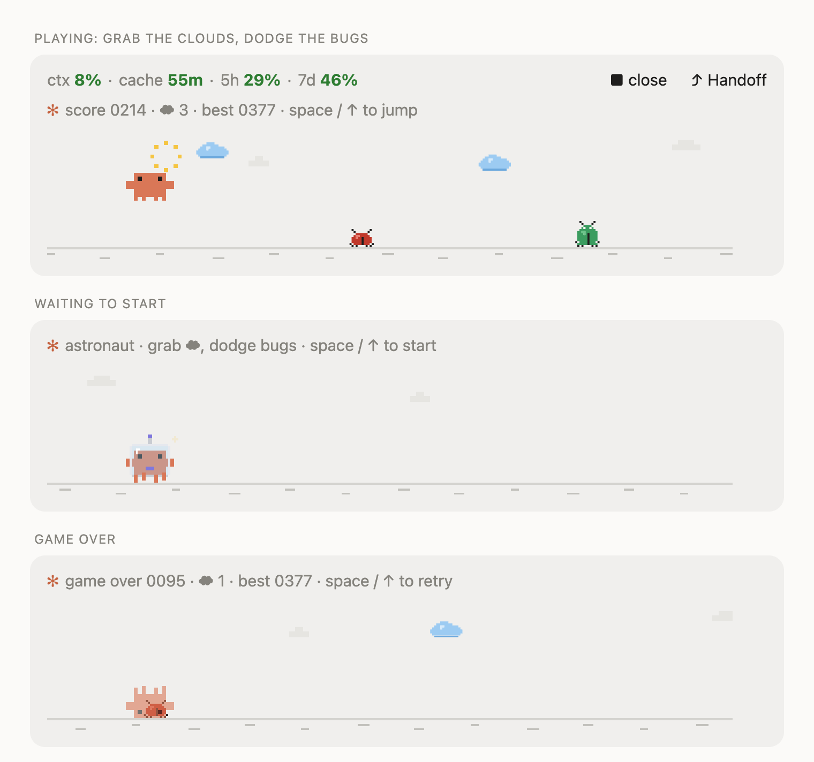
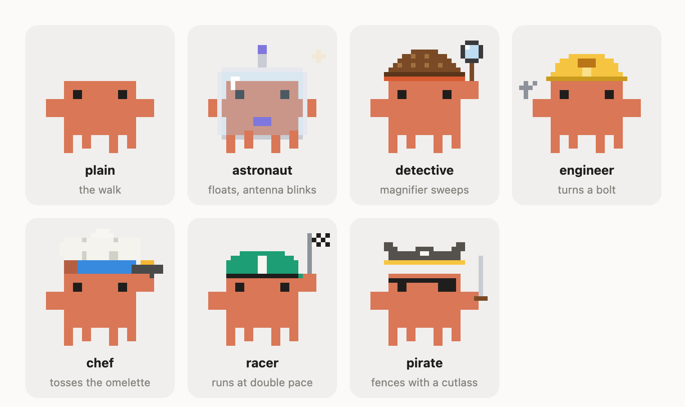

# status-band

A compact status band for **Claude Code** (desktop app and terminal), with a small game hidden in it.

- **Always on:** context %, prompt-cache countdown, 5-hour / 7-day usage limits, and a one-click **Handoff** that summarizes the chat, clears it, and pastes the summary into a fresh one.
- **While Claude works:** a tiny animated mascot with a timer, and a **▶ play** button that opens **Claude runner**: *grab the clouds, dodge the bugs* with the pixel Claude crab in seven costumes.

The game runs entirely on your machine and costs **no tokens**. (Handoff is the one feature that asks the model something: one summary request, answered through the warm prompt cache.)



## Quick start (2 minutes)

You need Claude Code with plugin hook modules (built and tested on **2.1.295**). Anyone can fork this repo and use it.

```bash
claude plugin marketplace add SohamShirsat/claude-status-band
claude plugin install status-band@soham-mods
```

Then **start a new session** (desktop: new chat in the Code tab; terminal: restart `claude`). A session keeps the plugin version it started with, so `/reload-plugins` in an open desktop chat is not enough.

Prefer your own copy? Fork it, then use `YOUR_NAME/claude-status-band` in the first command. To hack on it locally: `git clone` it, then `claude plugin marketplace add ./claude-status-band`.

Update later:

```bash
claude plugin marketplace update soham-mods
claude plugin update status-band@soham-mods
```

(then a new session again).

### Settings

Set them from the plugin's settings in Claude Code (`userConfig`):

| setting | values | default | what it does |
| --- | --- | --- | --- |
| `cacheTtlMinutes` | `5`, `60` | `60` | how long the cache countdown runs (60 = extended cache, 5 = standard) |
| `costume` | `auto`, `plain`, `astronaut`, `detective`, `engineer`, `chef`, `racer`, `pirate` | `auto` | the crab in the game; `auto` = a new costume every run |
| `buddy` | `game`, `mascot`, `off` | `game` | `game` = mascot + play button, `mascot` = animation only, `off` = nothing while Claude works |

## How to play

**Grab the blue clouds, dodge the bugs.**

| | |
| --- | --- |
| **Jump** | `Space` or `↑` with an **empty prompt box** (no click needed); `k` also jumps while a run is live; or click the guidance line above the picture, then `Space` / `↑` / `k` |
| **Start / retry** | the same keys, or click the guidance line |
| **Close** | `q` (after clicking the guidance line), or the **■ close** button in the band |
| **Clouds** | float in the air; reach one in a jump for **+25** and a sparkle |
| **Bugs** | ladybugs and (later in a run) big green beetles; touching one ends the run |
| **Score** | runs up while you survive; speeds up smoothly the longer you last; best score is kept between sessions |

Typing is never hijacked: the keys only play when the game is open **and the prompt box is empty**. Once you have started a draft, Space is a space again.



## What changed in 0.8.0

- Bugs replace the stones and cacti; blue clouds are collectible.
- Smoother and faster on the desktop: 25 frames a second (was 14), 75 units/s at the start (was 57), speeding up continuously instead of in steps; a late frame catches up so the speed stays true; a jump pressed just before landing is kept.
- One line of guidance instead of two: the line under the picture ("game over · space to retry, or click here") duplicated the line above it and is gone. The line above is now also the click target.
- Key handling hardened and instrumented (see [Troubleshooting](#troubleshooting)).

## Spec

### Where things draw

| surface | drawing | file |
| --- | --- | --- |
| desktop | a vector scene (SVG), 340 × 68 art-pixels, redrawn every 40 ms; text lines above | `hooks/crab/scene.ts`, `hooks/strip.tsx` |
| terminal | half-block pixels (two pixels per cell), 60 ms ticks | `hooks/runner.tsx`, `hooks/crab/mini.ts` |

The desktop draws text in a proportional font, which cannot lay block characters out as pixels; hence a picture there and half-blocks in a terminal. Both play the **same rules** (`hooks/crab/game.ts`), tuned twice.

### Rules (`hooks/crab/game.ts`)

One pure function, `step(game, config)`, advances a run one tick; no timers, no `$`. Callers own the clock.

| | desktop | terminal |
| --- | --- | --- |
| field | 340 units wide | 30–56 columns |
| tick | 40 ms | 60 ms |
| run speed | 3 → 5.6 units/tick (`3 + score/450`, capped) | 1 col/tick, 2 after 200 points |
| jump | 17 ticks, 30 units high, smooth parabola | 13 ticks, 3 pixels high |
| bugs | ladybug 12×9, big beetle 12×13 (after 60 points) | 1–2 × 2 pixels, 1 × 3 |
| bug hit-box | crab body 10 wide, bug trimmed 2 each side (legs and feelers are safe) | crab body 3 wide |
| clouds | 16×8, 34–48 units above ground | 4×1, top row |
| cloud reach | crab must lift ≥ cloud height − 24 | lift ≥ 2 |
| score | 0.6 / tick + 25 per cloud | 1 / tick + 25 per cloud |
| spacing | the gap between bugs always leaves room for a whole jump even at top speed | same |

### Keys: how they reach the game

The prompt box owns the keyboard, and a plugin drawing surface only gets keys after a click on it. So there are two routes:

1. **`prompt.edit` hook** (`hooks/register.tsx`): while the game is open and the box is empty, Space/↑ (and `k` while a run is live) are consumed there and turned into a jump. Any other key, or any non-empty draft, passes through untouched.
2. **A `Client` surface module** (`hooks/strip.tsx`): the guidance line. A click on it jumps and gives it the keyboard; it then reads Space / ↑ / `k` / `q` itself and posts them to the hooks module (`ui.message`).

All presses go through one atomic `update` on the shared game state, so a key and a timer tick that land together both count.

### Files

```
.claude-plugin/plugin.json    manifest, version, user settings
.claude-plugin/marketplace.json
hooks/register.tsx            the band, handoff, game control, keys, timers
hooks/runner.tsx              terminal game (Client module)
hooks/strip.tsx               desktop guidance line + key capture (Client module)
hooks/crab/game.ts            rules, configs, header text
hooks/crab/scene.ts           desktop SVG scene (crab, bugs, clouds, sparkles)
hooks/crab/master.ts, mini.ts full-size and game-size crab sprites
hooks/*.test.ts(x)            69 tests
assets/crab/                  the crab as SVG / PNG / JSON (see its README)
scripts/                      asset builder, scene preview, docs-image builder
docs/                         the images in this README
types/index.d.ts              the plugin's state contract
```

## Troubleshooting

- **Nothing changed after updating:** start a *new* session. Sessions pin the plugin version they started with.
- **Space / ↑ do nothing:** click the guidance line above the picture once, then try again. Also look at `~/.claude/status-band-trace.log`: it names the loaded version (`session.start vX.Y.Z`) and, while a game is open, logs the first few key edits (`edit key=…`) and presses (`press via=…`), which shows whether the key reached the plugin at all. Open an issue with those lines.
- **"No room for the game here":** the window is too short; make it taller (the game needs 7 rows).
- **Play button missing:** the band needs at least 30 columns, and `buddy` must be `game`.

## Develop

```bash
npx -y -p typescript tsc -p .      # type-check
claude plugin test .               # 69 tests
claude plugin validate .
```

After any edit: bump `version` in `.claude-plugin/plugin.json`, then `claude plugin update status-band@soham-mods`, then a new session.

Regenerate the images in `docs/` (screenshots of pages built from the mod's own scene code):

```bash
node --import ./scripts/ts-loader.mjs scripts/make-docs.ts /tmp/docs-build
# then screenshot preview.html (760 px wide) and costumes.html
```

Preview the scene art: `node --import ./scripts/ts-loader.mjs scripts/preview-scene.ts scene.html`.

## Credits and licence

MIT, see [LICENSE](LICENSE). The pixel crab ("Clawd") sprites come from [johnnyvizz/claude-kit](https://github.com/JohnnyVizz/claude-kit) (MIT, kept in `assets/crab/LICENSE-upstream`), which traces DockCrab's Clawdy.

This is an unofficial, community mod. It is not made by, affiliated with, or endorsed by Anthropic; "Claude" and the Claude mascot belong to their owners.
