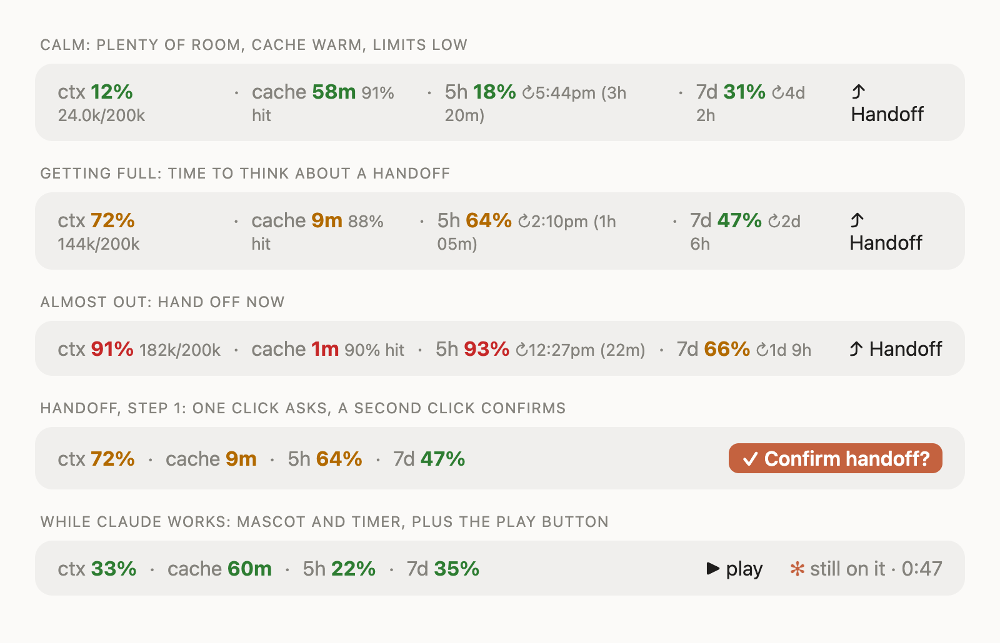
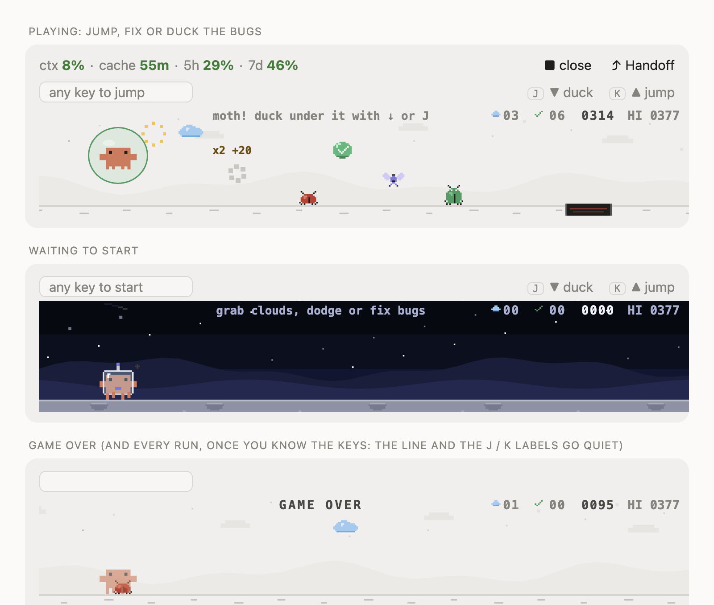
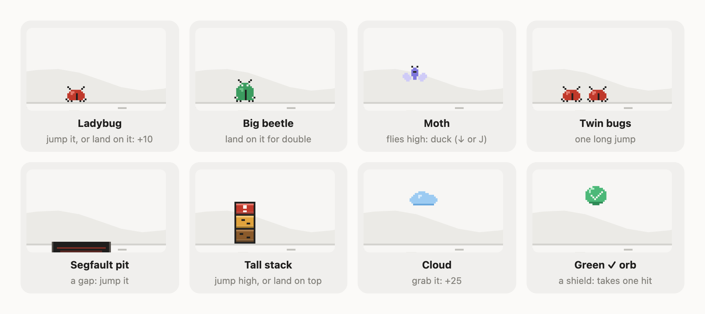
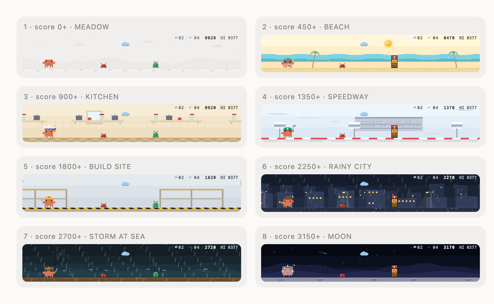

# Claude Cockpit

**A small dashboard for Claude Code, with a tiny game hidden inside.**

It sits above the box where you type, and it answers four questions you otherwise have to guess at:

1. **How full is this chat?** (`ctx`)
2. **Is my chat still "warm", or will the next message cost more?** (`cache`)
3. **How much of my usage allowance is left?** (`5h`, `7d`)
4. **Can I start fresh without losing my place?** (**⤴ Handoff**, one click)

And when Claude is busy for a while, there is a **▶ play** button: a small bug-fixing game with the Claude crab. It runs on your own computer and costs nothing.



Works in the **Claude Code desktop app** and in the **terminal**. Free and open source (MIT). The band and the game run on your machine; Handoff is the one feature that asks Claude something (a single summary request).

> This is a community project. It is not made by, affiliated with, or endorsed by Anthropic.

---

## Contents

- [Reading the band](#reading-the-band): what each number means
- [Handoff](#handoff-start-a-fresh-chat-without-losing-your-place): the one-click fresh start
- [When to use what](#when-to-use-what): everyday situations
- [The game](#the-game-for-when-claude-is-busy): how to play
- [Setup](#setup)
- [Settings](#settings)
- [Troubleshooting](#troubleshooting)
- [Privacy, and what this plugin runs](#privacy-and-what-this-plugin-runs)
- [For developers](#for-developers)

---

## Reading the band

```
ctx 72%  144k/200k  ·  cache 9m  88% hit  ·  5h 64%  ↻2:10pm (1h 05m)  ·  7d 47%  ↻2d 6h          ⤴ Handoff
```

Every number is **green** when things are fine, **amber** from 60 %, and **red** from 85 %. (Cache uses time instead: green above 10 minutes, amber above 2, red below.) On a narrow window the band shows just the main numbers; make the window wider to see the extra detail (`144k/200k`, `88% hit`, the `(1h 05m)` wait).

### `ctx`: how full the chat is

Claude can only keep so much in mind at once. That limit is called the **context window**. Everything in the chat counts toward it: what you wrote, what Claude replied, every file it read, every command output.

`ctx 72%` means the chat has used 72 % of that space. The small `144k/200k` beside it is the same thing in tokens (a token is roughly three-quarters of a word).

**Why you care:** when it gets close to full, Claude has to forget or squeeze older parts of the conversation, and answers can get vaguer. A long chat is also slower and uses more of your allowance. Around **70 %** is a good time to think about a fresh start; the **Handoff** button (below) makes that painless.

### `cache`: is the chat still warm?

Every time you send a message, Claude re-reads the *whole* conversation so far. That would be slow and costly, so the system keeps the earlier part in a short-term memory called the **prompt cache**. Reading from it is much faster and much cheaper, which makes it the reason long chats stay affordable.

The catch: **the cache goes cold if you stop talking for a while.** The countdown, `cache 9m`, is how long it will stay warm. It resets to full every time Claude replies. If it reaches `0`, the next message has to re-read everything the slow, full-price way (the next message is slower and uses more of your allowance).

The little `88% hit` is a report card for the last message: 88 % of what Claude read came from the cache. High is good.

**Why you care:** if you are about to step away, the cache will go cold. When you come back, you will know that your next message will be a "cold" one. It also tells you when a Handoff is cheapest: while the cache is warm, writing the summary is quick and cheap.

> **Two cache lengths exist.** Standard is **5 minutes**, extended is **60 minutes**. The band assumes 60 by default. If your setup uses 5, change the `cacheTtlMinutes` setting so the countdown is honest.

### `5h` and `7d`: your usage allowance

Claude plans don't give you unlimited use; they give you allowances that refill over time. The band shows two of them:

| shown as | what it is | how it works |
| --- | --- | --- |
| **5h** | the **5-hour window** | Your short-term allowance. It starts counting when you begin using Claude and refills 5 hours later. If it fills up, you wait for the reset. |
| **7d** | the **weekly limit** | A separate allowance for the whole week. Heavy users can hit this even if no single 5-hour stretch was full. |
| **spend** | the **spending cap** | Only appears if your account has an extra-usage spending limit set. |

The `↻` beside each says **when it resets**. The 5-hour window has no fixed schedule, so it shows the clock time it ends, with the wait in brackets on a wide band: `5h 93% ↻12:27pm (22m)` reads "I've used 93 % of this window, and it refills at 12:27pm, in 22 minutes", which means you can wait it out instead of burning through the rest. The weekly `7d` shows a countdown (`↻2d 6h`) on wide bands.

**Why you care:** you find out *before* you are cut off, and you can see whether it is worth waiting for a reset. A heavy afternoon can be paced around the `5h` number; a heavy week around `7d`.

> These numbers come straight from Claude Code, which only knows them for subscription accounts (Pro, Max and similar). If you use an API key, the `5h` and `7d` parts simply don't appear.

### Everything else on the band

- **`$0.42`**: the cost of this session so far, shown on wide windows when Claude Code reports it.
- **`✻ still on it · 0:47`**: while Claude works, a small mascot with a running timer, so you can tell "busy" from "stuck".
- **`▶ play`**: opens the game (see below).

---

## Handoff: start a fresh chat without losing your place

The button is on the right of the band (see the fourth row of the picture above for the confirm step).

### The problem

Long chats get heavy. The context fills up (`ctx` goes red), answers get fuzzier, and everything costs more. The obvious fix is to start a new chat, but then Claude knows nothing, and you spend ten minutes re-explaining what you were doing.

### The idea

**Handoff** has Claude write a short briefing for its future self, wipes the chat, and puts that briefing in the new chat's input box. Fresh, empty, fast, and Claude still knows where you left off.

### How it works, step by step

1. **Click `⤴ Handoff`.** The button changes to **✓ Confirm handoff?** (This is so you can't do it by accident; if you don't confirm within 6 seconds it goes back to normal.)
2. **Click it again.** Claude is asked to write a handoff note. It is told to be specific and short (at most about 450 words), in six parts:
   - **Goal**: what you are trying to do
   - **State**: what's done, what's half-done
   - **Decisions**: what was chosen and why, and what was rejected
   - **Files & places**: exact paths, commands, branches
   - **Next steps**: in order, the first one doable straight away
   - **Gotchas**: mistakes already made, your preferences, things not to redo
3. **A safety copy is saved** to `~/.claude/handoffs/` first (named by date and time), so the note can never be lost. The chat is cleared only after the note is safe.
4. **The chat is cleared** (the same as typing `/clear`).
5. **The note is pasted into the new, empty chat's input box**, ready to go, with a short instruction ("read this, confirm the goal and your first step, then continue"). **You press Enter** when you are ready.

The note also records the folder you were in, the git branch, whether there were uncommitted changes, and how full the old chat was.

### What it costs

One extra request to Claude (the summary). Because the band reads the chat through the warm cache, this is cheap **if the cache is still warm**, which is a good reason to hand off *before* `cache` runs down rather than after. Everything after that is a short chat, which is cheaper than the long one.

### What it will not do

- It does not touch your files or your code. It only writes a note.
- It does not send the note automatically; you read it, then press Enter.
- If anything fails (nothing to summarise yet, `/clear` didn't run, the box couldn't be filled), it tells you and leaves the chat as it was, and your saved copy is still in `~/.claude/handoffs/`.

---

## When to use what

| You see… | What it means | What to do |
| --- | --- | --- |
| `ctx` amber or red | The chat is getting full; Claude may get vaguer | Finish the thought you are on, then **Handoff** |
| `cache` low (or `–`) and you're about to leave | The next message will be a cold one | Hand off **now** while it's cheap, or accept that the first message back is slower |
| `5h` red, with `↻12:27pm (22m)` | You're nearly out of this 5-hour window | Wait for the reset, or switch to lighter tasks |
| `7d` amber on a Tuesday | You're using the week's allowance fast | Pace yourself: shorter chats, fewer huge file reads |
| Claude has been working for minutes | Nothing is wrong; it's a long task | Press **▶ play**, or step away |
| Switching to a different task | The old chat's context is just noise now | **Handoff** (or just clear), and start the new thing clean |
| Coming back after lunch | The cache has gone cold | Expect the first reply to be slow and costly; hand off if the chat is also large |

---

## The game: for when Claude is busy

Some of Claude's jobs take minutes. Instead of staring at a spinner, press **▶ play** (it pulses gently while Claude works). Claude's job is fixing bugs, so in the game **you are Claude, the crab, and the bugs are coming for you.**



*(The top picture is mid-run: the crab inside a green shield, a moth to duck, a cloud collected, a pit coming up. The numbers in the top right corner are the clouds collected, bugs fixed, your score and your best score; the top left stays clear so the crab's whole jump is in view. `GAME OVER` appears in the picture itself. The small field above the picture is where the keys land. For your first few runs it says what a key does and the buttons beside it name J (duck) and K (jump); after that it is empty and the labels go away, so nothing is left to read but the game.)*

It runs entirely on your computer: **no tokens, no cost, no slowdown for Claude.** Closing it takes one click.

### How to play

Run to the right. Things come at you. Do one of three things: **jump over it**, **land on it** (that fixes the bug and scores points), or **duck under it**.

| to… | press |
| --- | --- |
| **Jump** | **K**, **Space** or **↑**; or click **▲ jump** in the first game |
| **Duck** | **J** or **↓**; or click **▼ duck** in the first game. In mid-air, the same key makes you **dive** down twice as fast |
| **Start or retry** | **K** (or **Space** / **↑** from the prompt box) |
| **Close** | click **■ close** in the band |
| **Go back to typing** | **Esc** (your prompt is never hijacked: the keys only go to the game while the game has focus) |

### What comes at you



| thing | what to do | appears from |
| --- | --- | --- |
| **Ladybug** | Jump it, or **land on it** to fix it: +10 | the start |
| **Big beetle** | Jump it, or land on it for **double** | score 40 |
| **Moth** | It flies at chest height. **Duck** under it (or jump right over) | score 70 |
| **Twin bugs** | Two in a row: one long jump (landing on them fixes both) | score 120 |
| **Segfault pit** | A gap in the ground: jump it, or you fall in | score 180 |
| **Tall stack** | "Stack overflow": too tall for a lazy jump. Clear it near the top of your arc, or land on top | score 300 |
| **Blue cloud** | Reach it mid-jump: +25 and a sparkle | always |
| **Green ✓ orb** | "Tests passing!" Grab it for a **shield** that blocks one hit | rare |

**Chains:** land on bugs one after another *without touching the ground in between* and the points climb: +10, +20, +30…

**Gauntlets:** from about score 60 things sometimes come as a set piece (a bug and a beetle, a moth then a bug, a pit with a bug waiting on the far side, three bugs in a row). Each has more than one way through (one long jump, or a stomp chain), and each is checked by the tests to leave room for a human to do it at every speed.

The first time each new kind of thing appears, a note in the top row says what to do ("moth! duck under it with ↓ or J"), so you don't have to learn anything in advance. The game starts brisk and speeds up smoothly, reaching full speed by a score of about 800. Your best score is remembered between sessions.

### The journey: eight costumes, eight worlds

As your score climbs the crab **changes costume on its own, and the world changes with it**: the sky, the far scenery, the ground, the weather. Each new stage gives a small bonus (+25) and puts its name under the score for a moment. Each world stays for about half a minute, long enough to enjoy before the next one arrives. Nothing pauses and nothing moves: the bugs, the clouds and the crab look and behave the same in every world, only the picture behind them changes.



| score | costume | world |
| --- | --- | --- |
| 0 | plain | **Meadow**: the calm grey one |
| 450 | swimmer | **Beach**: sun, sea, palms, gulls |
| 900 | chef | **Kitchen**: shelves of pots with steam, tiled floor |
| 1350 | racer | **Speedway**: grandstand, billboards, speed lines, kerb |
| 1800 | engineer | **Build site**: cranes and girders, hazard stripes, sparks |
| 2250 | detective | **Rainy city**: night skyline, street lamps, rain |
| 2700 | pirate | **Storm at sea**: heavy rain, rolling waves, a ship on the horizon, a flash of lightning now and then |
| 3150 | astronaut | **Moon**: stars, the Earth, craters, a meteor now and then |

After the Moon it comes round again from the Meadow, and the game keeps getting faster. Every run starts again at the Meadow. If you would rather keep one costume (and its world) for the whole run, pick it in settings: then nothing changes. If you are sensitive to motion, the weather and other loops switch themselves off when your system asks for reduced motion.


### On the desktop and in the terminal

- **Desktop app:** a smooth picture, as wide as the band. Press **▶ play**, then **Space**. The first game of a session says its keys in the picture's message line (`K jump · J duck · …`, `bug! K jumps it, …`); after it the game is just the picture, and **K** (start, jump) and **J** (duck) still work.
- **Terminal:** a pixel-block version (two pixels per character cell). It plays when the game is open **and the prompt box is empty**, so it never steals keys while you are typing.

The rules are the same in both.

---

## Setup

### What you need

[Claude Code](https://claude.com/claude-code) with support for plugin hook modules. Built and tested on version **2.1.295**. Nothing else to install.

### Install (two commands)

```bash
claude plugin marketplace add SohamShirsat/claude-cockpit
claude plugin install status-band@claude-cockpit
```

Then **start a new session** (desktop app: a new chat in the Code tab; terminal: quit and run `claude` again). A session keeps the version of the plugin it started with, so reloading an already-open chat will not show it.

You should see the band above the prompt box right away. If you don't, jump to [Troubleshooting](#troubleshooting).

### Update later

```bash
claude plugin marketplace update claude-cockpit
claude plugin update status-band@claude-cockpit
```

and then, again, a new session.

### Remove

```bash
claude plugin uninstall status-band@claude-cockpit
```

### Use your own copy

Fork this repository on GitHub, then use `YOUR_NAME/claude-cockpit` in the first command. To work on it locally, `git clone` it and add the folder instead: `claude plugin marketplace add ./claude-cockpit`.

---

## Settings

Change these from the plugin's settings in Claude Code.

| setting | choices | default | what it does |
| --- | --- | --- | --- |
| `cacheTtlMinutes` | `5`, `60` | `60` | How long the `cache` countdown runs. Set it to match your cache: 60 for the extended cache, 5 for the standard one. |
| `costume` | `auto`, `plain`, `swimmer`, `astronaut`, `detective`, `engineer`, `chef`, `racer`, `pirate` | `auto` | The crab's outfit. `auto` is the journey: the costume and the world change as your score climbs. Name one to keep it (and its world) for the whole run. |
| `buddy` | `game`, `mascot`, `off` | `game` | While Claude works: `game` = mascot and the play button, `mascot` = just the animation, `off` = nothing. |
| `motion` | `smooth`, `classic` | `smooth` | `smooth` = the display animates the game (steady at any speed). `classic` = redrawn step by step; use it only if a screen doesn't animate the picture. |

---

## Troubleshooting

- **I installed it, but nothing changed.** Start a *new* session. Open sessions keep the plugin version they began with.
- **The band shows `–` for `cache` or `ctx`.** Normal in a brand-new chat: the numbers appear after Claude's first reply.
- **No `5h` / `7d`.** Those come from your Claude subscription. With an API key, Claude Code has no allowance to report.
- **The keys don't play the game.** The keys are read at the prompt box, so the prompt box has to be the thing that has the focus: press **Esc** (or click the prompt box) and try Space again. The mod writes what it sees to `~/.claude/status-band-trace.log` (kept across sessions, time-stamped). Look for `session.start vX.Y.Z` to see which version a chat loaded.
- **"No room for the game here".** The window is too short. Make it taller; the game needs about 9 rows.
- **No ▶ play button.** The band needs at least 30 columns, and the `buddy` setting must be `game`.
- **Handoff said it didn't clear.** Type `/clear` yourself and paste: your note is saved in `~/.claude/handoffs/`.

---

## Privacy, and what this plugin runs

Cockpit is a *mod*: code that runs inside Claude Code on your machine. Everything it does is listed here, call by call.

**It does not use the network.** It makes no web requests (it never calls `$.http` or `$.mcp`), has no server, no analytics, no telemetry and no account. It bundles no MCP server and no package to download, and runs nothing from a package registry (`npx`, `uvx` and the like). Nothing it reads is sent to the author or any third party.

**What it reads**
- Your session's own numbers, which Claude Code hands to the mod: context use, cache timing, and the 5-hour and weekly limits (`$.session.usage`, the `session.measure` event).
- The session's working folder (`$.session.cwd`) and its turn count (`$.session.turns`).
- The `HOME` environment variable (`$.env.get('HOME')`), only to find `~/.claude`. It reads no other environment variable, no credential and no token.
- Only when you press Handoff: the state of the git repository you are in, with three read-only `git` commands (below).

**What programs it starts.** Only `git`, only on Handoff, only these four fixed commands in the session's working folder, each with a 4-second limit: `git rev-parse --path-format=absolute --show-toplevel --git-dir --git-common-dir`, `git branch --show-current`, `git rev-parse --short HEAD`, and `git status --porcelain -uno`. They change nothing in the repository.

**What it writes (all on your machine)**
- `~/.claude/status-band-trace.log`: a short debugging log (the last few hundred lines) of what the band and the game keys did: button presses, version, errors. It records no prompt text, no conversation content, and no typed characters other than the game's own keys (Space, ↑, J, K). It is a plain log: no tool reads or runs it. Delete it any time.
- `~/.claude/handoffs/<time>.md`: the handoff note, saved only when you press Handoff, as a safety copy before the chat is cleared. It is a plain note; no tool runs it, and the mod never edits a settings, start-up, build or instructions file.
- A small saved state in Claude Code's own mod store (`$.store`) and session state (`$.state`): your game best score, and the current band numbers.

**The one thing that talks to Claude: Handoff.** When you press **⤴ Handoff** and confirm, the mod does exactly this, in order:
1. `$.model.fork`: asks a fork of the same Claude session to write a short summary note (so the fork can read the conversation, through Claude Code's own model call; it uses your normal Claude usage).
2. Saves the note to `~/.claude/handoffs/` as a safety copy.
3. `$.command.run`: runs one slash command, **`/clear`**, and nothing else, to start a fresh chat. It runs `/clear` only after the note is saved, and only because you pressed Handoff.
4. `$.prompt.fill`: puts the note into the new chat's prompt box for you to read and send. It never submits it for you.

The conversation goes nowhere else: no network call exists. Handoff never runs on its own. The band, the mascot and the game make no model call and cost no tokens.

**Every Claude Code call the mod makes** (the full list; nothing else is used):

| call | what for |
| --- | --- |
| `$.session.usage`, `$.session.cwd`, `$.session.turns` | the band's numbers; the working folder and turn count for Handoff |
| `$.clock.now`, `$.clock.after`, `$.clock.every` | timers: the cache countdown, the mascot, the game's steps |
| `$.ui.resolve`, `$.ui.invalidate`, `$.ui.open`, `$.ui.close`, `$.ui.toast` | drawing the band and the game pane, and short notices |
| `$.store.get`, `$.store.set` | your game best score |
| `$.fs.read`, `$.fs.write` | the trace log and the handoff note in `~/.claude` (nothing else is read or written) |
| `$.env.get` | `HOME` only |
| `$.process.run` | the four fixed `git` commands above, on Handoff only |
| `$.model.fork`, `$.command.run`, `$.prompt.fill` | Handoff: the summary request, `/clear`, and filling the prompt box |

**Hooks it registers.** `session.start`, `session.end`, `session.measure`, `prompt.edit` and `prompt.submit` (to let Space and ↑ play the game while the game is open and the prompt box is empty; any other text passes through unchanged and is never stored), `turn.complete`, `tool.call` (observes only, to know when Claude is working; it never denies, changes or answers a tool call), `ui.render`, `ui.press`, `ui.message` and `ui.close` (the band, the game pane and their buttons).

**It does not** read your files other than the two logs above, collect personal data, store credentials, read any other environment variable, or send anything anywhere.

**Who it is for:** developers using Claude Code. It is not directed at children.

Questions or problems: open an issue at <https://github.com/SohamShirsat/claude-cockpit/issues>.

## For developers

```bash
npx -y -p typescript tsc -p .      # type-check
claude plugin test .               # 145 tests
claude plugin validate .
```

After any edit: raise `version` in `.claude-plugin/plugin.json`, run `claude plugin update status-band@claude-cockpit`, and start a new session.

Where to look:

| file | what it is |
| --- | --- |
| `hooks/register.tsx` | the band, Handoff, game control, keys, timers |
| `hooks/crab/game.ts` | the game's rules (one pure function) |
| `hooks/crab/scene.ts` | the desktop picture |
| `hooks/runner.tsx`, `hooks/crab/mini.ts` | the terminal game |
| `assets/crab/` | the crab artwork (SVG, PNG, JSON) |
| [`docs/TECHNICAL.md`](docs/TECHNICAL.md) | how it works inside: rules table, smooth motion, key routing |
| [`CHANGELOG.md`](CHANGELOG.md) | what changed in each version |

Before every push run `python3 scripts/preflight.py`: it checks the plugin against the plugin directory's rules (see [`docs/DIRECTORY-COMPLIANCE.md`](docs/DIRECTORY-COMPLIANCE.md)).

To rebuild the pictures in `docs/` (they are made from the mod's own drawing code):

```bash
node --import ./scripts/ts-loader.mjs scripts/make-docs.ts /tmp/docs-build
# then take screenshots of the .wrap / .grid element of band.html, preview.html (saved as game.png),
# guide.html, costumes.html and journey.html, at 2x scale
```

## Credits and licence

MIT, see [LICENSE](LICENSE). The pixel crab ("Clawd") comes from [johnnyvizz/claude-kit](https://github.com/JohnnyVizz/claude-kit) (MIT, kept in `assets/crab/LICENSE-upstream`), which traces DockCrab's Clawdy.

"Claude" and the Claude mascot belong to their owners.
